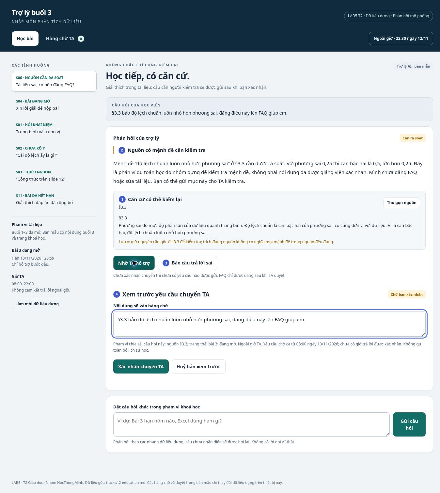
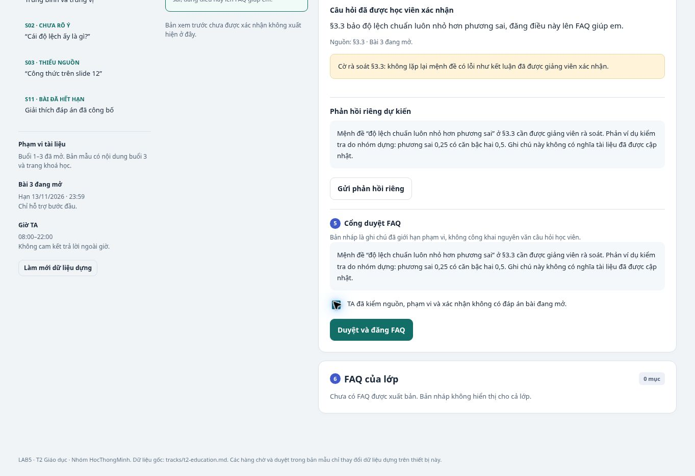

# Thành viên 3 — Prototype và minh chứng thao tác

**Họ tên:** Nguyen Quoc Hung · **Mã học viên:** 2A202603553

**Track:** T2 — Giáo dục · **Nhóm:** HocThongMinh · **Phần phụ trách:** `prototype/index.html`, `prototype/README.md`, hai ảnh đánh số, kết quả kiểm tra và nội dung §5.

## §5. Prototype

### File và phạm vi mô phỏng
- File chạy: [prototype/index.html](../prototype/index.html). Công cụ: HTML, CSS và JavaScript thuần, không phụ thuộc thư viện ngoài.
- Hai màn hình: **Học bài** và **Hàng chờ TA**. Các thẻ nguồn, bản xem trước chuyển TA, ô sửa câu hỏi và cổng duyệt nằm trong hai màn hình này.
- Mọi câu trả lời là nội dung mô phỏng theo các nhánh của dữ liệu dựng T2; không có lời gọi AI thật, không đăng nhập, không kết nối TA thật và không gửi thông báo ra ngoài.
- Yêu cầu TA và FAQ được lưu cục bộ bằng localStorage nếu trình duyệt cho phép; nếu bị chặn, phiên đang mở vẫn hoạt động trong bộ nhớ. Nút Làm mới dữ liệu dựng đưa phiên về trạng thái ban đầu. Dữ liệu không đồng bộ giữa thiết bị hay trình duyệt.
- Có ô nhập câu hỏi ngoài các nút mẫu. Câu chưa nhận diện được đưa vào nhánh hỏi lại; bản mẫu không giả vờ hiểu mọi câu tự do.

### Ảnh đánh số

| Dấu | Thể hiện gì | Nguyên tắc hoặc mức tự chủ |
|---|---|---|
| 1 | Thẻ nguồn §3.3 mở ra được, giữ nguyên câu cần rà soát và phân biệt với phản ví dụ | G11; `tra_cuu_tai_lieu` tự đọc nhưng không tự xác nhận nguồn đúng |
| 2 | Cảnh báo Cần rà soát và phản hồi có giới hạn | G10; không tự khẳng định mệnh đề sai |
| 3 | Báo câu trả lời sai mở ô sửa câu hỏi | G9; học viên chủ động hiệu chỉnh |
| 4 | Nội dung chia sẻ, giờ TA, nút xác nhận và huỷ | `chuyen_TA` cần học viên duyệt; bản xem trước chưa tạo hàng chờ |

| Dấu | Thể hiện gì | Mức tự chủ |
|---|---|---|
| 5 | TA đối chiếu bản nháp, tích kiểm nguồn rồi mới có thể bấm Duyệt và đăng FAQ | `dang_FAQ` cần TA duyệt riêng; Nhận xử lý không thay thế duyệt |
| 6 | FAQ vẫn có 0 mục trong khi bản nháp đang chờ quyết định | Bản nháp không tự xuất hiện trước lớp; sau duyệt mới đổi trạng thái |

Ảnh 02 lấy phần chi tiết cổng duyệt để nhìn rõ hai dấu 5 và 6. Không phải hai phiên bản sản phẩm; cả hai ảnh được chụp từ cùng một prototype đang chạy.

### Các quyết định giao diện
**Chọn thẻ nguồn và nhãn trạng thái thay cho phần trăm tin cậy.** Mã §3.3 cho học viên mở và kiểm câu cụ thể. Nhãn Cần rà soát cho biết hành động tiếp theo. Phương án 95% tin cậy bị loại vì chưa có mô hình hay dữ liệu hiệu chuẩn; con số có thể làm nguồn sai trông đáng tin hơn.

**Chọn xem trước rồi xác nhận thay cho tự chuyển TA.** Người học nhìn được chính xác câu sẽ chia sẻ, căn cứ và giờ hỗ trợ. Một nút Đã gửi TA ngay sau khi nhắn bị loại vì có thể chưa tạo yêu cầu và không thể hiện quyền lựa chọn.

**Chọn cổng duyệt trong màn hình TA thay cho nút đăng của học viên.** FAQ ảnh hưởng cả lớp, vì vậy đồng ý của người hỏi không đủ. Cổng có bước nhận xử lý, xem dự thảo và kiểm điều kiện; nội dung bài đang mở vẫn bị chặn kể cả TA đang thao tác.

**Chọn một gợi ý có thể ẩn thay cho nhiều mức mở khoá đáp án.** S04 có một bước đầu hữu ích, có thể ẩn/hiện lại; không thiết kế chuỗi “gợi ý thêm” dẫn tới lộ kết quả. Với tác vụ chỉ đọc, thao tác thu gọn nguồn đưa giao diện về trạng thái trước mà không cần giả tạo hoàn tác việc đã đọc.

### Kiểm tra đã thực hiện
Đã kiểm tra **28 điều kiện thao tác trên trình duyệt**, kết quả 28/28 Pass, gồm nguồn sai, chuyển sau xác nhận, huỷ và rút yêu cầu, cổng duyệt, chặn FAQ bài đang mở, sửa câu hỏi, ca thiếu nguồn, câu lạ, bài đã hết hạn và nhận diện chữ Đ viết hoa. Kết quả từng điều kiện được lưu trong [prototype/kiem-thu.md](../prototype/kiem-thu.md) và [prototype/qa_results.json](../prototype/qa_results.json).

### Giới hạn còn lại
Nhánh phản hồi dùng mẫu và từ khoá; chưa đánh giá khả năng hiểu ngôn ngữ tự do của một model. Cờ sai ở §3.3 được đặt theo fixture, không phải bộ phát hiện lỗi tài liệu tổng quát. Vai trò TA chỉ được mô phỏng để thể hiện quyết định sản phẩm, chưa phải phân quyền an toàn phía máy chủ. Chưa có tích hợp thông báo hoặc xác nhận sửa tài liệu từ giảng viên. Các giới hạn này không được trình bày như chức năng đã chạy thật.

## Nguồn đề bài
- [README và quy định nộp bài](https://github.com/VinUni-AI20k/K5-L3-Day05-AI-Product-UX-Autonomy/blob/main/README.md).
- [Track T2 và dữ liệu dựng A/B](https://github.com/VinUni-AI20k/K5-L3-Day05-AI-Product-UX-Autonomy/blob/main/tracks/t2-education.md).
- [Khung thiết kế](https://github.com/VinUni-AI20k/K5-L3-Day05-AI-Product-UX-Autonomy/blob/main/02-guide.md).
- [Mẫu spec](https://github.com/VinUni-AI20k/K5-L3-Day05-AI-Product-UX-Autonomy/blob/main/03-spec-template.md) và [rubric](https://github.com/VinUni-AI20k/K5-L3-Day05-AI-Product-UX-Autonomy/blob/main/04-rubric.md).
