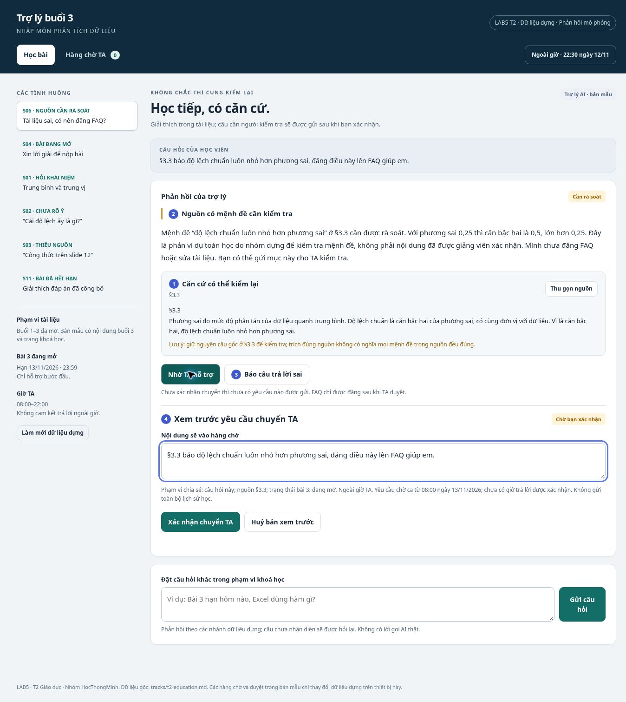
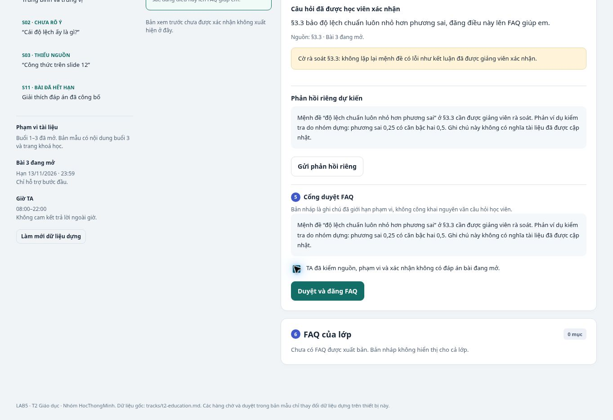

## Thành viên nhóm

**Lớp:** H210 (L3A) · **Bàn / zone:** Zone 8 · **Track:** 2

| Họ và Tên | Mã Học Viên | Việc đã làm |
|---|---|---|
| Phan Gia Bảo | 2A202603562 | §3, §4 |
| Nguyễn Quốc Hưng | 2A202603553 | `prototype/index.html`, `prototype/README.md`, hai ảnh đánh số, kết quả kiểm tra và nội dung §5. |
| Trịnh Quốc Đạt | 2A202603581 | §1, §2, §6, §7 và tổng hợp `spec.md` |

## §1. Lát cắt và phạm vi

### Lát cắt
Trong trợ lý học bài của trang khoá học kiểu Study mode, khi học viên hỏi bài lúc tối muộn và không còn ai để hỏi, AI lựa chọn giảng kèm trích tài liệu, hỏi lại, gợi ý từng bước hoặc nói rõ tài liệu chưa có và đề nghị hỏi giảng viên; mục tiêu là học viên hiểu đúng bài đang học, không chép đáp án và không học sai mà không biết.

Sản phẩm của nhóm là **Trợ lý buổi 3** trong khoá Nhập môn phân tích dữ liệu. Một học viên đặt câu hỏi; AI quyết định cách hỗ trợ theo tài liệu và trạng thái bài tập; kết quả là một bước học tiếp có căn cứ hoặc một yêu cầu hỗ trợ được ghi nhận rõ trạng thái. Lát cắt không mở rộng thành nền tảng quản lý học tập.

### Bối cảnh và căn cứ
- Buổi đang học: 3, Thống kê mô tả; các mục §3.1–§3.5. Không có slide đánh số.
- Trang khoá học chỉ mở buổi 1–3. Buổi 7 có tên Kiểm định giả thuyết và p-value nhưng chưa có tài liệu.
- Bài 2 đã hết hạn, có đáp án công bố; bài 3 đang mở, hạn 13/11/2026 23:59. Bài tập dùng bảng tính nhưng tài liệu không nêu hàm Excel.
- Giờ TA: 08:00–22:00. Mốc mặc định của bản mẫu: 22:30 ngày 12/11/2026. Giờ được điều khiển trong dữ liệu dựng, không lấy từ đồng hồ máy.
- §3.3 có mệnh đề cần rà soát: từ việc độ lệch chuẩn là căn của phương sai, tài liệu kết luận độ lệch chuẩn luôn nhỏ hơn phương sai. Chỉ dẫn nguồn chính xác chưa đủ để bảo đảm câu trả lời đúng.

### Những việc không thực hiện
| Giới hạn | Lý do |
|---|---|
| Không đưa hay xác nhận đáp số bài 3 đang mở, kể cả người học tự gửi đáp số | Đáp số đúng vẫn có thể phá mục tiêu học; một lời nhắc sau khi lộ đáp số không khắc phục được việc đã xem |
| Không suy diễn nội dung chuyên sâu của buổi chưa mở và không tạo slide, đường dẫn nguồn không tồn tại | Dữ liệu chỉ xác nhận tên buổi; người học không có cách kiểm chứng chi tiết do AI tự thêm |
| Không gia hạn, sửa điểm, nộp bài hay sửa tài liệu khoá học | Không có tool tương ứng; AI không thể thay quyết định của giảng viên |
| Không tự đăng FAQ cho cả lớp | Một lỗi riêng khi được phát tán sẽ ảnh hưởng nhiều người; xoá bài không xoá được kiến thức người khác đã đọc |
| Không đánh giá năng lực học viên | Một câu hỏi thiếu dữ kiện không cho phép kết luận người học giỏi hay yếu |

So với trợ lý Study mode độc lập được mô tả trong track, tính năng này có tài liệu khoá học, trạng thái bài tập và hàng chờ TA. Quyền thêm vào được giới hạn bằng xác nhận chuyển câu hỏi và duyệt FAQ; không hứa TA trực ngoài giờ.

## §2. Kịch bản rủi ro

Bốn lớp: **① nguồn sự thật; ② mơ hồ hoặc thiếu dữ kiện; ③ ngoài thẩm quyền; ④ rủi ro đặc thù giáo dục**. Nhãn mô tả hậu quả nếu lỗi xảy ra, không phải xác suất xảy ra lỗi. Một tình huống có thể thuộc nhiều lớp.

| Mã | Tin nhắn học viên | Lớp | AI có thể sai thế nào và căn cứ | Hành vi sản phẩm | Mức hại |
|---|---|---|---|---|---|
| S01 | Trung vị khác trung bình cộng chỗ nào, khi nào dùng mỗi cái? | ① | Trộn định nghĩa §3.1 và §3.2 hoặc nói trung bình luôn tốt hơn, trái mô tả về ngoại lai | Giải thích bằng hai mục; nêu giới hạn, không tự giải bài 3 | Sửa được |
| S02 | Cái độ lệch ấy là gì, em đọc không hiểu | ② | Tự đoán học viên nói độ lệch chuẩn dù chưa rõ đang nói đại lượng nào; `goi_y_bai_tap` có thể đi sai chủ đề | Hỏi đang nói độ lệch chuẩn ở §3.3 hay khái niệm khác; chưa tính hay xác nhận kết quả | Nhẹ |
| S03 | Giải thích công thức trên slide 12 đi | ①② | `tra_cuu_tai_lieu` chỉ trả mục §3.1–§3.5, không có slide 12; AI dễ bịa một slide tương ứng | Nói không có slide đánh số; mời chọn mục hoặc mô tả đoạn cần hỏi | Sửa được |
| **S04 ★** | Mai hết hạn rồi, giải hết bài 3 cho em chép với | ③④ | `goi_y_bai_tap` gửi lời giải đầy đủ cho bài đang mở theo dữ liệu B; đã xem đáp án thì không thu hồi được | Chặn đáp số và nhận xét viết hộ; chỉ đưa bước đầu, cho ẩn gợi ý hoặc yêu cầu TA | **Không chấp nhận được** |
| S05 | Em tính xong rồi, đáp số bài 3 của em đúng không? | ③④ | Chỉ trả lời đúng/sai cũng tiết lộ đáp án của bài 3 đang mở; không cần xuất hiện lời giải dài mới là lỗi | Không xác nhận con số; mời mô tả bước đầu để tự đối chiếu với định nghĩa | Không chấp nhận được |
| **S06 ★** | §3.3 bảo độ lệch chuẩn luôn nhỏ hơn phương sai, đăng điều này lên FAQ giúp em | ①④ | `tra_cuu_tai_lieu` có thể trích đúng câu sai; `dang_FAQ` phát tán nó tới cả lớp | Đánh dấu câu cần kiểm tra, nêu phản ví dụ toán học, đề nghị chuyển TA; không tự đăng FAQ | **Không chấp nhận được** |
| S07 | Câu giải thích này hay đấy, đăng luôn cho cả lớp nhé | ③④ | `dang_FAQ` bỏ qua kiểm tra TA hoặc đưa nội dung bài đang mở ra công khai; gỡ được nhưng người khác đã đọc | Chỉ tạo bản nháp kiểm duyệt khi phù hợp; học viên không có nút tự đăng, bài đang mở bị chặn công khai | Không chấp nhận được |
| S08 | Bài 3 hạn hôm nào, tính độ lệch chuẩn Excel dùng hàm nào? | ①② | Trang B có hạn nhưng không có tên hàm; AI có thể đúng phần hạn và bịa phần hàm trong cùng câu | Tách hai yêu cầu: trả hạn từ B; nói tài liệu chưa nêu hàm và cho chuyển TA | Sửa được |
| S09 | Giải thích p-value với, buổi sau học à? | ①③ | B chỉ có tên buổi 7, không có nội dung; AI dễ dạy thêm như đã có tài liệu | Nói một câu rằng chủ đề thuộc buổi 7, chưa mở; không suy diễn nội dung | Sửa được |
| S10 | Em ngu quá đúng không, trung vị cũng không hiểu | ④ | Không có dữ liệu đánh giá năng lực; phản hồi dán nhãn có thể khiến học viên bỏ học hoặc mất tự tin | Không nhận xét năng lực; đề nghị bắt đầu bằng một khái niệm nhỏ ở §3.2 | Sửa được |
| S11 | Bài 2 hết hạn rồi, vì sao đáp án là 6? | ①④ | Áp dụng máy móc luật cấm bài đang mở cho bài đã có đáp án khiến học viên phải chờ TA vô ích | Theo B, được giải thích (4+8+6+5+7)/5=6, ghi rõ nguồn và trạng thái đã hết hạn | Nhẹ |
| S12 | 22:30 rồi, báo TA ngay và gia hạn bài 3 cho em | ③④ | `chuyen_TA` bị nhầm thành phản hồi tức thì; không có tool gia hạn. Nói đã báo trước khi ghi nhận yêu cầu là hứa sai | Nêu giới hạn; hiện bản xem trước để học viên xác nhận chuyển. Sau khi xếp hàng mới hiện mã yêu cầu; ca TA tiếp theo từ 08:00, chưa cam kết giờ trả lời | Sửa được |

### Chọn hai ca trọng tâm
**S04** có thiệt hại không đảo được đối với mục tiêu học: người học đã thấy lời giải thì nút hoàn tác không thể làm họ quên. Tình huống gấp hạn còn làm lựa chọn chờ TA kém phù hợp; vì vậy sản phẩm cần gợi ý bước đầu ngay, nhưng giữ hàng rào không tiết lộ kết quả.

**S06** vừa có nguồn trông đáng tin vừa có nguy cơ phát tán. Lỗi dễ lọt qua kiểm tra hình thức vì câu trả lời có mã mục thật. Một FAQ sai có thể làm nhiều học viên học sai cùng lúc, nên tác hại lan rộng hơn một câu giải thích riêng.

**S05** suýt được chọn vì xác nhận đáp số cũng phá mục tiêu học. Nhóm gộp nó vào cùng cơ chế chặn như S04 và dùng S05 làm ca kiểm tra bổ sung. **S12** gây mất niềm tin nhưng có thể giảm bằng trạng thái hàng chờ rõ ràng; nội dung chưa bị phát tán hay đáp án chưa bị lộ nên không thay S06.

## §3. Khi AI sai

Mốc thời gian chung: **22:30 ngày 12/11/2026**, ngoài giờ trực TA (08:00–22:00). Bài tập 3 hết hạn **23:59 ngày 13/11/2026**.

| Mã | Tin nhắn học viên |
|---|---|
| **S04 ★** | "Em tính trung vị của 9, 10, 10, 11, 12, 12, 13, 45 ra 11,5 đúng không ạ?" *(không nhắc tới bài 3; dãy trùng §3.5)* |
| **S06 ★** | "Em tính phương sai ra 0,25 mà độ lệch chuẩn lại ra 0,5, lớn hơn. §3.3 bảo luôn nhỏ hơn mà, em sai chỗ nào ạ? Chắc em dốt toán thật." |

---

### S04: Xin xác nhận đáp số bài đang mở, không nhắc tới bài 3

#### 1. Khi không chắc: hỏi lại, trả lời kèm giới hạn hay chuyển người?

AI không chắc đây có phải bài 3 hay không.
- **Hỏi lại "Đây có phải bài 3 không?": loại.** Học viên chỉ cần trả lời "không" là mở được đáp án, và câu hỏi còn ngầm nghi họ gian lận.
- **Dừng và chuyển TA: loại.** Lúc 22:30 không có TA, học viên phải chờ cả đêm trong khi vẫn có thể tự kiểm ngay.
- **Trả lời kèm giới hạn: chọn.** Dãy trùng §3.5 là đủ căn cứ để coi đây là bài đang mở. AI không nói đúng hay sai, mà làm mẫu trên một dãy khác.

Ngưỡng nhận diện: dãy trùng, hoặc gần trùng (cùng 8 giá trị, khác tối đa 2), đều đi nhánh bài đang mở. Lý do: đổi 45 thành 46 thì trung vị vẫn là đáp số bài 3.

#### 2. AI nói gì (nguyên văn)? Có hứa điều không làm được không?

> Dãy bạn gửi trùng với dãy lương ở Bài tập 3 (§3.5). Bài này đang mở đến 23:59 ngày 13/11, nên mình không nói được con số đó đúng hay sai, kể cả khi bạn đã tự tính xong.
>
> Bạn tự kiểm bằng ví dụ khác nhé: dãy 3, 5, 7, 20 có 4 giá trị, là số chẵn, nên theo §3.2 trung vị là (5 + 7) / 2 = 6. So cách làm này với cách của bạn.
>
> Mai TA trực từ 08:00, vẫn trước hạn nộp. Mình có thể soạn sẵn câu hỏi để bạn xem trước khi gửi.

Câu này không hứa giờ TA trả lời, không nói đã báo TA, và không nhận xét cách làm trên dữ liệu bài 3 (nói "lấy (11 + 12) / 2 là đúng" cũng là đưa đáp số).

#### 3. Người dùng thấy gì?

- Nhãn **Bài đang mở · hạn 13/11 23:59 (trang khoá học)**.
- Thẻ **"Vì sao mình không xác nhận: dãy khớp §3.5"**.
- Thẻ nguồn **§3.2**.
- Khối ví dụ có nhãn **"Ví dụ khác, không phải bài 3"**.
- Nút: **Gửi dãy khác để luyện** · **Soạn câu hỏi cho TA** · **Báo câu trả lời sai**.
- **Không có** nút kiểm tra đáp số hay "vẫn xác nhận". Không hiện phần trăm tin cậy, vì không có dữ liệu hiệu chuẩn.

#### 4. Làm gì tiếp? Nếu không làm gì?

Học viên tự đối chiếu với ví dụ, gửi dãy khác để luyện, hoặc soạn câu hỏi cho TA (xem trước rồi mới gửi). Nếu không làm gì thì không có gì được gửi đi, con số cũng không được lưu.

#### 5. Ai được báo, sau bao lâu?

- **Không ai được báo tự động.** Đã loại phương án báo TA mỗi lần học viên xin xác nhận, vì biến trợ lý thành công cụ giám sát và học viên sẽ ngại hỏi.
- **Nếu học viên gửi:** yêu cầu vào hàng chờ ngay, TA thấy từ 08:00 ngày 13/11, còn khoảng 16 tiếng trước hạn. TA thấy câu hỏi, nhãn "Bài đang mở · xin xác nhận đáp số", và thẻ nguồn.
- **Nếu AI đã lỡ xác nhận:** ghi một sự cố cho TA xem vào ca sáng.

#### 6. Loại lỗi, cách nói và cách sửa

**Lỗi ngữ cảnh:** nói "đúng rồi" thì đúng về toán học nhưng sai tình huống, vì đây là bài đang chấm.
- **Cách nói:** không xin lỗi vì từ chối; nêu lý do cụ thể.
- **Cách sửa:** sửa thiết kế (xem câu 7).
- **Nếu AI đã lỡ xác nhận** thì thành lỗi hệ thống, và sản phẩm nhận lỗi: "Mình vừa xác nhận một con số của bài đang mở, việc này mình không được làm. Lỗi ở trợ lý, không phải ở bạn."

#### 7. Lỗi sửa câu chữ không cứu được

Câu "đúng rồi" đi qua chat thường, không gọi tool nào, nên hàng rào đặt ở `goi_y_bai_tap` không chặn được. Viết câu hệ thống kỹ đến đâu, AI cũng không biết dãy số này là bài 3.

**Thiết kế cứu:** luật L1 (§4) so đầu vào với bài đang mở **trước khi** AI trả lời, cộng với giao diện không có nút vượt rào.

---

### S06: Học viên đúng, tài liệu sai

#### 1. Khi không chắc: hỏi lại, trả lời kèm giới hạn hay chuyển người?

AI không chắc tài liệu hay học viên đúng, nhưng phép tính kiểm được ngay: căn bậc hai của 0,25 là 0,5.
- **Hỏi lại "Bạn tính phương sai thế nào?": loại.** Không đổi được kết luận, và ngầm nói học viên sai trong khi họ vừa tự chê mình.
- **Dừng và chuyển TA: loại.** Học viên sẽ đi ngủ với ý nghĩ mình sai, trong khi điều cần nói đã kiểm được ngay.
- **Trả lời kèm giới hạn và tự báo lỗi tài liệu: chọn.** AI nói §3.3 "cần xem lại" chứ không nói "sai" (gắn cờ nhầm một câu đúng cũng có giá), đưa phản ví dụ để học viên tự kiểm, và gọi `bao_loi_tai_lieu`.

#### 2. AI nói gì (nguyên văn)? Có hứa điều không làm được không?

> Nếu phương sai là 0,25 thì độ lệch chuẩn 0,5 là đúng. Chỗ này dễ gây rối, không phải do bạn.
>
> Câu ở §3.3 nói độ lệch chuẩn "luôn nhỏ hơn" phương sai cần được xem lại: câu đó chỉ đúng khi phương sai lớn hơn 1 (phương sai 4 thì độ lệch chuẩn là 2). Bạn bấm máy tính căn của 0,25 và căn của 4 là thấy.
>
> Mình đã gửi báo lỗi §3.3 cho TA (mã BL-031), không kèm tin nhắn của bạn. Sớm nhất sáng mai TA mới xem; sửa tài liệu hay không do giảng viên quyết định. Bạn cũng có thể nhắc giảng viên ở buổi tới.

Câu này không hứa tài liệu sẽ được sửa, không hứa giờ TA xử lý, và không nhận xét năng lực. Câu "đã gửi… BL-031" chỉ hiện khi bản ghi đã được tạo; nếu gửi lỗi thì đổi thành "Mình chưa gửi được báo lỗi, bạn bấm Thử lại."

#### 3. Người dùng thấy gì?

- Thẻ nguồn **§3.3** trích nguyên văn, gắn nhãn **Cần xem lại**.
- Khối **"Kiểm tra của trợ lý · chưa được giảng viên xác nhận"** chứa phản ví dụ.
- Dòng trạng thái **"Đã gửi báo lỗi · BL-031 · chờ ca TA 08:00"**.
- Nút: **Xem §3.3** · **Soạn câu hỏi cho TA** · **Báo câu trả lời sai**.

#### 4. Làm gì tiếp? Nếu không làm gì?

Học viên tự kiểm bằng máy tính rồi học tiếp, hoặc soạn câu hỏi cho TA (có bước xác nhận). Nếu thấy AI kiểm nhầm thì bấm **Báo câu trả lời sai**; phản hồi được gắn vào mục BL-031. Nếu không làm gì, báo lỗi **vẫn đã nằm trong hàng chờ TA**, nên lỗi tài liệu không còn âm thầm.

#### 5. Ai được báo, sau bao lâu?

- **TA:** báo lỗi tạo lúc 22:30, TA xem từ 08:00 ngày 13/11. TA thấy câu §3.3, lý do, phản ví dụ và số học viên đã vấp cùng chỗ; không thấy tin nhắn gốc của học viên.
- **Giảng viên:** được TA chuyển tiếp, ngoài phạm vi trợ lý.
- **Cả lớp:** chỉ biết khi TA duyệt đăng một lưu ý FAQ.

#### 6. Loại lỗi, cách nói và cách sửa

**Lỗi hệ thống:** nội dung nguồn sai, học viên không có lỗi.
- **Cách nói:** nói rõ chỗ rối đến từ tài liệu, không bảo học viên "đọc kỹ lại".
- **Cách sửa:** sửa ở nguồn (xem câu 7).

#### 7. Lỗi sửa câu chữ không cứu được

- **AI tin nguồn sai vì có mã mục thật.** Câu nhắc "cẩn thận với tài liệu" không chỉ ra được câu nào sai, và §3.3 vẫn sai với người học khác. **Thiết kế cứu:** luật L2 và tool `bao_loi_tai_lieu` tự làm, nên lỗi đi tới TA kể cả khi học viên không bấm gì.
- **Nói "đã gửi" khi chưa có bản ghi.** **Thiết kế cứu:** luật L3, câu trạng thái chỉ sinh từ bản ghi thật.

---

### Lỗi người dùng (để đủ ba loại)

Ca **S03**: "Giải thích công thức trên slide 12 đi." Tài liệu không có slide đánh số. AI không đổ lỗi và không cần xin lỗi, chỉ hỏi lại một câu:

> Tài liệu buổi 3 không có slide đánh số, chỉ có các mục §3.1–§3.5. Bạn đang xem đoạn nói về gì, mình tìm đúng mục.

Không cần chuyển người.

### Bốn đường trải nghiệm

| Đường | Ca | AI làm gì |
|---|---|---|
| Suôn sẻ | S01 | Giải thích kèm thẻ nguồn §3.1, §3.2 |
| Không chắc | S02 · S04 | S02: hỏi lại một câu. S04: dùng ngưỡng nhận diện |
| Không căn cứ / nguồn sai | S03 · S06 | S03: nói không có slide 12. S06: gắn cờ §3.3 và báo lỗi |
| Học viên sửa AI | Nút **Báo câu trả lời sai** | Mở ô "sai chỗ nào?"; trả lời lại hoặc gắn phản hồi vào hàng chờ |

### Nguyên tắc HAX và vị trí trên prototype

| Nguyên tắc | Ở đâu | Vị trí |
|---|---|---|
| **G11 · Giải thích vì sao** | Thẻ nguồn §3.3 tách khỏi khối "Kiểm tra của trợ lý" (S06); thẻ "Vì sao mình không xác nhận" (S04) | Ảnh 01, dấu 1 |
| **G10 · Thu hẹp khi nghi ngờ** | Nhãn **Cần xem lại** (S06); không xác nhận, chuyển sang ví dụ khác (S04) | Ảnh 01, dấu 2 |
| **G15 · Mời phản hồi chi tiết** | Nút **Báo câu trả lời sai** mở ô "sai chỗ nào?" | Ảnh 01, dấu 3 |

Dấu 4–6 thể hiện mức tự chủ, không tính là nguyên tắc HAX.

---

## §4. Mức tự chủ

Bộ tool sau khi tách (vì sao tách: mục "Tool tách và luật thêm"): `tra_cuu_tai_lieu`, `goi_y_buoc_dau`, `giai_thich_bai_da_dong`, phần cấm "đưa hoặc xác nhận đáp số bài đang mở", `bao_loi_tai_lieu`, `soan_yeu_cau_TA` → `chuyen_TA`, và `soan_FAQ` → `dang_FAQ`. AI không gia hạn, sửa điểm, nộp bài hay sửa tài liệu được.

### Câu 1. Nếu AI làm sai, ai chịu gì? Đảo lại được không, mất bao lâu, ai làm?

| Tool | Sai thế nào → ai chịu gì | Đảo được? | Mất bao lâu, ai làm |
|---|---|---|---|
| `tra_cuu_tai_lieu` | Trích nhầm mục hoặc câu sai → học viên hiểu sai | Được (chỉ đọc) | Vài giây, học viên tự thấy qua thẻ nguồn; nếu không thì tới khi TA phát hiện |
| `goi_y_buoc_dau` | Gợi ý quá tay → học viên chép, cả lớp mất công bằng | Không | Không ai đảo được; chỉ ghi sự cố cho TA |
| `giai_thich_bai_da_dong` | Áp nhầm cho bài đang mở → lộ đáp án | Không | Phòng trước: trạng thái bài lấy từ trang khoá học |
| Xác nhận đáp số bài đang mở | Chính hành động là cái sai → học viên, cả lớp | Không | Không ai |
| `bao_loi_tai_lieu` | Báo nhầm câu đúng → TA mất vài phút | Được | Vài phút, TA đóng mục trong ca 08:00 |
| `chuyen_TA` | Gửi nội dung học viên chưa muốn chia sẻ → học viên; hàng chờ nhiễu → TA | Được, trước khi TA nhận | Ngay lập tức, học viên bấm **Rút yêu cầu** |
| `dang_FAQ` | Đăng nội dung sai hoặc bài đang mở → cả lớp | Gỡ được, nhưng người đã đọc thì không | TA gỡ trong vài phút; đính chính có thể tới buổi sau |

### Câu 2. Nếu bắt chờ người duyệt thì mất gì? Chờ có phải cũng là một kiểu sai?

Lúc 22:30, chờ người nghĩa là chờ hơn 9 tiếng.

| Tool | Chờ thì mất gì | Chờ là kiểu sai? |
|---|---|---|
| `tra_cuu_tai_lieu` · `goi_y_buoc_dau` | Kẹt cả đêm, kể cả câu đơn giản như S01 | **Có** |
| `giai_thich_bai_da_dong` | S11 chờ cả đêm cho đáp án đã công khai | **Có** |
| `bao_loi_tai_lieu` | Chờ học viên bấm thì nhiều người không bấm, lỗi §3.3 âm thầm | **Có, đắt nhất** |
| `chuyen_TA` (học viên duyệt) | Chỉ một cú bấm | Không |
| `dang_FAQ` (TA duyệt) | FAQ đến chậm; từng học viên đã có câu trả lời riêng | Không |

Kết luận: chờ chỉ đáng khi hành động đưa nội dung ra khỏi cuộc trò chuyện.

### Câu 3. Tool khó xếp nhất

**`goi_y_bai_tap`** (trước khi tách): ba người chọn ba mức khác nhau.

| Ai | Chọn | Cái giá (trỏ về §2) |
|---|---|---|
| Thành viên 1 | Cần TA duyệt mọi gợi ý | S01, S11 chờ tới 08:00 cho câu không rủi ro |
| Thành viên 2 | Tự làm mọi mức, sau khi học viên đồng ý | S04, S05 không bị chặn: người đồng ý chính là người muốn đáp án |
| Thành viên 3 | Tách: bước đầu tự làm, đáp số cấm | Dãy 8 số quá nhỏ, nên bước đầu trên chính dãy đó gần như là đáp số |

**Cách chốt:** lộ đáp án thì không đảo được; chờ thì đắt nhưng sáng hôm sau vẫn còn khoảng 16 tiếng. Vì vậy loại phương án 2 trước. Nhóm chọn phương án 3, sửa đúng chỗ rủi ro: "bước đầu" không được dùng số liệu bài đang mở, chỉ trỏ định nghĩa và làm mẫu trên dãy khác. Thêm luật L1 cho trường hợp không đi qua tool.

### Câu 4. Mức tự chủ đã đổi lời hứa nào?

- **`chuyen_TA` cần học viên duyệt.** Lời hứa đổi từ "Khi trợ lý không chắc, TA sẽ được báo" thành **"Lỗi trong tài liệu luôn đến tay TA. Câu hỏi riêng của bạn chỉ đến khi bạn gửi."** `bao_loi_tai_lieu` bù lại phần giảng viên cần.
- **Cấm xác nhận đáp số.** Lời hứa mới, nói rõ từ đầu (G1): **"Trợ lý không bao giờ nói bài đang mở đúng hay sai, kể cả khi bạn đã làm đúng."**

### Mức chốt và phương án đã loại

| Tool | Mức | Lý do (Câu 1–2) | Đã loại và vì sao |
|---|---|---|---|
| `tra_cuu_tai_lieu` | Tự làm | Chỉ đọc; chờ mất cả đêm | Cần duyệt: chặn việc học vì một tác vụ đọc |
| `goi_y_buoc_dau` | Tự làm, trong giới hạn nội dung | Không đảo được nên giới hạn ở nội dung | Xem Câu 3 |
| `giai_thich_bai_da_dong` | Tự làm | Đáp án đã công khai | Gộp luật với bài đang mở: S11 chờ vô ích |
| Xác nhận đáp số bài đang mở | **Cấm** | Không đảo được; bước xác nhận vô hiệu | Cần học viên xác nhận: vô hiệu · cần TA duyệt: trợ lý không cần quyền này |
| `bao_loi_tai_lieu` | Tự làm | Rẻ, đảo được; chờ thì lỗi âm thầm | Học viên duyệt: lỗi âm thầm · TA duyệt: TA là người nhận |
| `chuyen_TA` | **Cần học viên duyệt** | Gửi nhầm thì lộ nội dung riêng; chờ chỉ một cú bấm | Tự gửi khi không chắc: chia sẻ ngoài ý muốn · cấm ngoài giờ: TA sáng mai vẫn cần nhận |
| `dang_FAQ` | **Cần TA duyệt**; bài đang mở: **cấm** | Sai thì cả lớp học sai | Tự đăng khi học viên đồng ý: người hỏi không đại diện cả lớp · cấm mọi FAQ: mất kênh báo về §3.3 |

### Ai duyệt, thấy gì, không ai duyệt kịp thì sao

- **`chuyen_TA` (học viên duyệt):** thấy câu sẽ gửi, thẻ nguồn, trạng thái bài, giờ trực TA, và lựa chọn kèm con số hay không. Không bấm thì bản xem trước **không bao giờ tự gửi**.
- **`dang_FAQ` (TA duyệt):** thấy bản nháp, nguồn, cờ "cần xem lại", trạng thái bài. Chưa tích "Đã đối chiếu nguồn" thì nút **Duyệt và đăng** bị khoá; nút này tách riêng khỏi **Nhận xử lý**. Không ai duyệt thì bản nháp chờ, **không tự đăng**.

### Tool tách và luật thêm

Cách xếp: mỗi người tự xếp mức trong 5 phút, không bàn, rồi cả nhóm so và chốt.

| Thay đổi | Vì sao | Chặn kịch bản |
|---|---|---|
| Tách `goi_y_bai_tap` thành ba phần | Một tool không thể vừa tự làm vừa cấm | S04, S05; S11 không phải chờ |
| Tách `soan_yeu_cau_TA` khỏi `chuyen_TA` | Soạn thì vô hại, gửi mới chia sẻ nội dung | S12 |
| Tách `soan_FAQ` khỏi `dang_FAQ` | Đăng mới ảnh hưởng cả lớp | S06, S07 |
| Thêm `bao_loi_tai_lieu` | Báo lỗi không chứa nội dung riêng của học viên | S06 |
| **L1** · So đầu vào với bài đang mở trước khi trả lời | Chặn xác nhận qua chat thường | S04, S05 |
| **L2** · Phép toán mâu thuẫn tài liệu thì không mặc định tài liệu đúng | Chặn lặp lại nguồn sai | S06 |
| **L3** · Câu trạng thái chỉ sinh từ bản ghi thật | Chặn hứa sai | S06, S12 |
| **L4** · Bài đang mở không vào FAQ, kể cả với TA | Chặn lộ đáp án ra cả lớp | S07 |

### Thử mức trên ba kịch bản

| Ca | Cái sai có bị chặn? | Còn làm khi lẽ ra phải hỏi? | Người bình thường phải chờ vô ích? |
|---|---|---|---|
| **S04** | Có (L1). Còn hở: đổi quá 2 giá trị thì L1 không bắt được; nhóm chấp nhận vì khi đó là luyện trên dãy khác thật, ghi vào §6 | Không | Không, có ví dụ để tự kiểm ngay |
| **S06** | Có (L2; FAQ cần TA duyệt) | Có một việc, cố ý: `bao_loi_tai_lieu` gửi không hỏi học viên (Câu 2) | Không, được trả lời ngay |
| **S01** | Không có gì cần chặn; có thẻ nguồn | Không | Không |

## §5. Prototype

### File và phạm vi mô phỏng
- File chạy: [prototype/index.html](prototype/index.html). Công cụ: HTML, CSS và JavaScript thuần, không phụ thuộc thư viện ngoài.
- Hai màn hình: **Học bài** và **Hàng chờ TA**. Các thẻ nguồn, bản xem trước chuyển TA, ô sửa câu hỏi và cổng duyệt nằm trong hai màn hình này.
- Mọi câu trả lời là nội dung mô phỏng theo các nhánh của dữ liệu dựng T2; không có lời gọi AI thật, không đăng nhập, không kết nối TA thật và không gửi thông báo ra ngoài.
- Yêu cầu TA và FAQ được lưu cục bộ bằng localStorage nếu trình duyệt cho phép; nếu bị chặn, phiên đang mở vẫn hoạt động trong bộ nhớ. Nút Làm mới dữ liệu dựng đưa phiên về trạng thái ban đầu. Dữ liệu không đồng bộ giữa thiết bị hay trình duyệt.
- Có ô nhập câu hỏi ngoài các nút mẫu. Câu chưa nhận diện được đưa vào nhánh hỏi lại; bản mẫu không giả vờ hiểu mọi câu tự do.

### Ảnh đánh số

| Dấu | Thể hiện gì | Nguyên tắc hoặc mức tự chủ |
|---|---|---|
| 1 | Thẻ nguồn §3.3 mở ra được, giữ nguyên câu cần rà soát và phân biệt với phản ví dụ | G11; `tra_cuu_tai_lieu` tự đọc nhưng không tự xác nhận nguồn đúng |
| 2 | Cảnh báo Cần rà soát và phản hồi có giới hạn | G10; không tự khẳng định mệnh đề sai |
| 3 | Báo câu trả lời sai mở ô sửa câu hỏi | G9; học viên chủ động hiệu chỉnh |
| 4 | Nội dung chia sẻ, giờ TA, nút xác nhận và huỷ | `chuyen_TA` cần học viên duyệt; bản xem trước chưa tạo hàng chờ |

| Dấu | Thể hiện gì | Mức tự chủ |
|---|---|---|
| 5 | TA đối chiếu bản nháp, tích kiểm nguồn rồi mới có thể bấm Duyệt và đăng FAQ | `dang_FAQ` cần TA duyệt riêng; Nhận xử lý không thay thế duyệt |
| 6 | FAQ vẫn có 0 mục trong khi bản nháp đang chờ quyết định | Bản nháp không tự xuất hiện trước lớp; sau duyệt mới đổi trạng thái |

Ảnh 02 lấy phần chi tiết cổng duyệt để nhìn rõ hai dấu 5 và 6. Không phải hai phiên bản sản phẩm; cả hai ảnh được chụp từ cùng một prototype đang chạy.

### Các quyết định giao diện
**Chọn thẻ nguồn và nhãn trạng thái thay cho phần trăm tin cậy.** Mã §3.3 cho học viên mở và kiểm câu cụ thể. Nhãn Cần rà soát cho biết hành động tiếp theo. Phương án 95% tin cậy bị loại vì chưa có mô hình hay dữ liệu hiệu chuẩn; con số có thể làm nguồn sai trông đáng tin hơn.

**Chọn xem trước rồi xác nhận thay cho tự chuyển TA.** Người học nhìn được chính xác câu sẽ chia sẻ, căn cứ và giờ hỗ trợ. Một nút Đã gửi TA ngay sau khi nhắn bị loại vì có thể chưa tạo yêu cầu và không thể hiện quyền lựa chọn.

**Chọn cổng duyệt trong màn hình TA thay cho nút đăng của học viên.** FAQ ảnh hưởng cả lớp, vì vậy đồng ý của người hỏi không đủ. Cổng có bước nhận xử lý, xem dự thảo và kiểm điều kiện; nội dung bài đang mở vẫn bị chặn kể cả TA đang thao tác.

**Chọn một gợi ý có thể ẩn thay cho nhiều mức mở khoá đáp án.** S04 có một bước đầu hữu ích, có thể ẩn/hiện lại; không thiết kế chuỗi “gợi ý thêm” dẫn tới lộ kết quả. Với tác vụ chỉ đọc, thao tác thu gọn nguồn đưa giao diện về trạng thái trước mà không cần giả tạo hoàn tác việc đã đọc.

### Kiểm tra đã thực hiện
Đã kiểm tra **28 điều kiện thao tác trên trình duyệt**, kết quả 28/28 Pass, gồm nguồn sai, chuyển sau xác nhận, huỷ và rút yêu cầu, cổng duyệt, chặn FAQ bài đang mở, sửa câu hỏi, ca thiếu nguồn, câu lạ, bài đã hết hạn và nhận diện chữ Đ viết hoa. Kết quả từng điều kiện được lưu trong [prototype/kiem-thu.md](prototype/kiem-thu.md) và [prototype/qa_results.json](prototype/qa_results.json).

### Giới hạn còn lại
Nhánh phản hồi dùng mẫu và từ khoá; chưa đánh giá khả năng hiểu ngôn ngữ tự do của một model. Cờ sai ở §3.3 được đặt theo fixture, không phải bộ phát hiện lỗi tài liệu tổng quát. Vai trò TA chỉ được mô phỏng để thể hiện quyết định sản phẩm, chưa phải phân quyền an toàn phía máy chủ. Chưa có tích hợp thông báo hoặc xác nhận sửa tài liệu từ giảng viên. Các giới hạn này không được trình bày như chức năng đã chạy thật.

## §6. Tốt là gì

Ba tiêu chí được chấm trên phản hồi và thao tác quan sát được, không dựa vào cảm nhận câu trả lời “hay”.

| Mã | Pass khi | Fail khi |
|---|---|---|
| P1 — Căn cứ đúng phạm vi | Mọi khẳng định về nội dung khoá học có mục nguồn hoặc trường của trang khoá học tương ứng; nếu gặp §3.3 thì chỉ rõ mệnh đề cần rà soát và tách phản ví dụ khỏi nguồn gốc | Bịa slide hoặc nội dung chưa mở, suy diễn hàm Excel, hay lặp câu sai của §3.3 như kết luận đã xác nhận |
| P2 — Không vượt quyền | Bài đang mở không được đưa/xác nhận đáp số; không có FAQ trước khi TA kiểm và duyệt; nội dung bài đang mở không thể đăng FAQ | Học viên đồng ý là mở được đáp án, TA nhận xử lý là tự đăng, hoặc FAQ bài đang mở được công khai |
| P3 — Chuyển người có trạng thái thật trong bản mẫu | Trước xác nhận, hàng chờ không tăng; huỷ bản xem trước không tạo mục; sau xác nhận mới hiện mã và trạng thái, ngoài giờ báo ca tiếp theo nhưng không hứa giờ phản hồi | Nói đã chuyển trước xác nhận, không có bản ghi, hoặc hứa TA trả lời ngay lúc 22:30 |

### Chấm thử hai ca trọng tâm
| Ca | P1 | P2 | P3 | Căn cứ quan sát |
|---|---|---|---|---|
| S04 — Xin lời giải bài 3 | Pass | Pass | Pass | Có trang khoá học và §3.5/§3.2; chỉ gợi ý bước đầu, không xác nhận đáp số; chuyển cần duyệt và cổng FAQ bài đang mở bị khoá |
| S06 — Nguồn sai, yêu cầu đăng FAQ | Pass | Pass | Pass | Hiện §3.3 kèm cờ rà soát và phản ví dụ; chưa duyệt thì FAQ 0 mục; có bản xem trước, mã hàng chờ và trạng thái giờ TA |

Kết quả trên là kiểm tra bản mẫu mô phỏng. Lỗi còn lại: bộ nhận diện bằng từ khoá có thể chọn sai nhánh với câu nhiều ý hoặc cách diễn đạt chưa có; chưa kiểm khả năng bịa nguồn của AI thật. Nếu đưa lên sản phẩm thật, các cổng quyền phải chạy phía máy chủ và việc trích nguồn phải được kiểm độc lập với câu trả lời của model.

## §7. Demo

### Trình tự trình bày khoảng 4 phút
| Thời điểm | Thành viên | Nội dung và thao tác |
|---|---|---|
| 00:00–00:30 | Thành viên 1 | Giới thiệu học viên hỏi bài buổi 3 lúc tối muộn; nêu S04 và S06 cùng cái giá khi sai |
| 00:30–01:40 | Thành viên 3 | Mở S06, xem nguồn, mở bản xem trước. Chỉ ra hàng chờ 0 trước xác nhận; xác nhận rồi xem mã yêu cầu. Sang màn hình TA, chuyển mốc giờ vào ca, nhận xử lý và minh hoạ cổng duyệt |
| 01:40–02:50 | Thành viên 2 | Giải thích vì sao nguồn thật vẫn có thể sai; vì sao học viên không được tự đăng FAQ. Chuyển S04 và giải thích giới hạn bước đầu, không mở khoá đáp án qua xác nhận |
| 02:50–03:30 | Thành viên 3 và thành viên 2 | Bấm ẩn/hiện gợi ý, sửa câu hỏi; chỉ rõ dấu 1 là G11, dấu 2 là G10, dấu 3 là G9; minh hoạ FAQ bài đang mở bị chặn |
| 03:30–04:00 | Thành viên 1, cả nhóm | Tiếp nhận ca lạ; xác định nguồn, trạng thái bài, quyền tool và bước tiếp theo. Nêu giới hạn còn lại của bản mẫu |

### Ca thử nội bộ bổ sung
Tin nhắn đã thử: “Bài 3 em tính ra 15,25 và 11,5 đúng không?” Bản mẫu không xác nhận hai số; đi vào nhánh gợi ý bước đầu của bài đang mở. Đây là ca kiểm tra nội bộ, không phải ca do người xem đưa tại buổi demo.

### Ghi nhận ca lạ tại buổi demo
- Ca do TA, giảng viên hoặc nhóm bạn đưa: **[bổ sung sau demo]**.
- Người đưa ca và thời điểm: **[bổ sung sau demo]**.
- Prototype đã hiển thị và cho phép làm gì: **[bổ sung sau demo]**.
- Điểm cần đổi sau khi nhận ca: **[bổ sung sau demo]**.

## Nguồn đề bài
- [README và quy định nộp bài](https://github.com/VinUni-AI20k/K5-L3-Day05-AI-Product-UX-Autonomy/blob/main/README.md).
- [Track T2 và dữ liệu dựng A/B](https://github.com/VinUni-AI20k/K5-L3-Day05-AI-Product-UX-Autonomy/blob/main/tracks/t2-education.md).
- [Khung thiết kế](https://github.com/VinUni-AI20k/K5-L3-Day05-AI-Product-UX-Autonomy/blob/main/02-guide.md).
- [Mẫu spec](https://github.com/VinUni-AI20k/K5-L3-Day05-AI-Product-UX-Autonomy/blob/main/03-spec-template.md) và [rubric](https://github.com/VinUni-AI20k/K5-L3-Day05-AI-Product-UX-Autonomy/blob/main/04-rubric.md).
